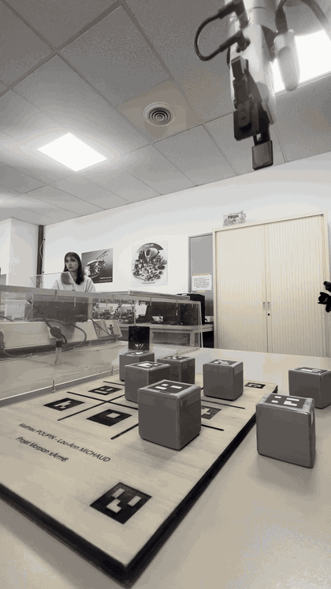
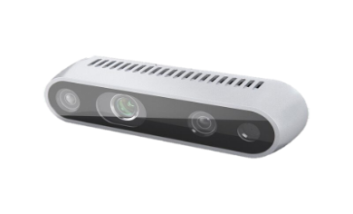
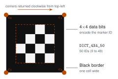
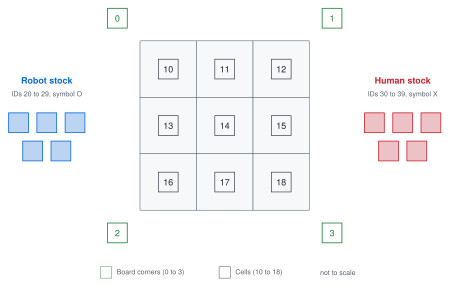
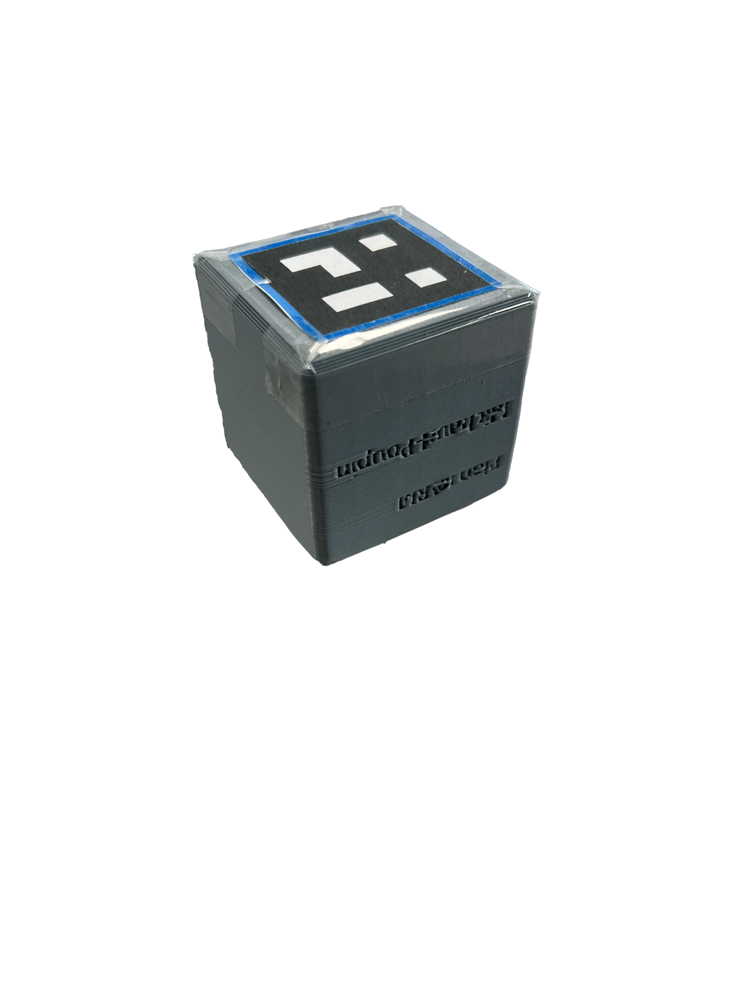
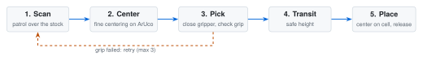
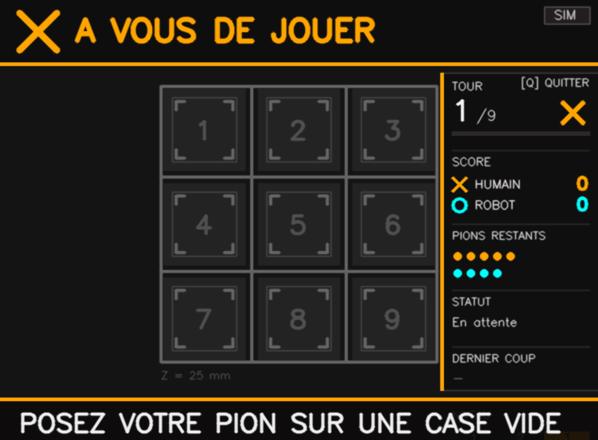
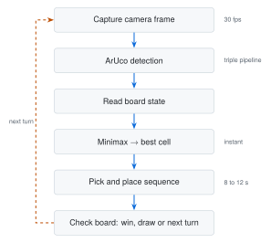

# xArm6 Autonomous Tic-Tac-Toe

**A UFactory xArm6 robotic arm playing tic-tac-toe against a human, guided by an Intel RealSense D435 depth camera and ArUco fiducial markers.**

Matthieu POUPIN & Lou-Ann MICHAUD, ENSEIRB-MATMECA, Electronics Engineering, 2025–2026  
Supervisors: M. Pierre Melchior & M. Matthieu Chevrié, EEL8-PROJ1 [BRA]

<p align="center">
  
</p>

## Demo

<p align="center">
  
</p>

[Full demo video (3 min)](https://www.youtube.com/watch?v=widBD34P_L8)

---

## Overview

The robot reads the board in real time from ArUco markers, picks its move with Minimax and alpha-beta pruning, takes a pawn from its stock and places it on the target cell. Once the game has started, nobody needs to touch it.

We built it as a demonstration for the ENSEIRB-MATMECA open days. The program is about 2 700 lines of Python in a single file, which makes it easier for the next students to pick up and run.

- Vision: Intel RealSense D435, ArUco markers (DICT_4X4_50), three-pass detection
- Game: three difficulty levels, the hardest being an unbeatable Minimax with alpha-beta pruning
- Control: xArm Python SDK over Ethernet (TCP/IP), camera mounted on the wrist (eye-in-hand)
- HUD: OpenCV overlay on the live feed with the board state, scores and status
- Simulation mode: the game can be played without any hardware, with mouse clicks instead of pawns

---

## Hardware

| Component | Role |
|-----------|------|
| UFactory xArm6 | 6-DOF robotic arm, 700 mm reach, ±0.1 mm repeatability, TCP/IP control |
| xArm Gripper | End-effector, 86 mm opening |
| Intel RealSense D435 | RGB 640×480 @ 30 fps + depth, mounted on the wrist (eye-in-hand) |
| Laser-engraved wood board | CTP 29.7×42 cm (A3), 3×3 grid with ArUco markers on each cell and corner |
| 3D-printed PLA pawns | 50 mm cubes, unique ArUco marker glued on top face (print sheets in `cad/`) |

<p align="center">
  
  <br><em>Intel RealSense D435: RGB + depth camera, mounted eye-in-hand on the wrist</em>
</p>

### ArUco addressing plan (DICT_4X4_50)

| ID range | Role |
|----------|------|
| 0–3 | Board corners (calibration) |
| 10–18 | Game cells |
| 20–29 | Robot pawns (blue, symbol O) |
| 30–39 | Human pawns (red, symbol X) |

<p align="center">
  <picture>
    <source media="(prefers-color-scheme: dark)" srcset="assets/aruco-diagram-dark.svg">
    
  </picture>
  <br><em>Anatomy of an ArUco marker</em>
</p>

<p align="center">
  <picture>
    <source media="(prefers-color-scheme: dark)" srcset="assets/board-layout-dark.svg">
    
  </picture>
  <br><em>Board layout: corners, cells, robot stock (blue) and human stock (red)</em>
</p>

<p align="center">
  
  <br><em>Laser-engraved board with 3D-printed pawns</em>
</p>

<p align="center">
  
  <br><em>Robot pawn (blue border) vs human pawn (red border)</em>
</p>

---

## Software architecture

Everything is in `morpion.py`, split into these sections:

| Section | Class / Module | Role |
|---------|---------------|------|
| 0 | `ConfigManager` | JSON config externalization (`config_robot.json`) |
| 1 | `MorpionIA` | AI: 3 difficulty levels including Minimax alpha-beta |
| 2 | `RobotController` | ~900 lines, all high-level robot movements |
| 3 | `dessiner_*` | HUD overlay on live camera feed (OpenCV) |
| 4 | `VisionSystem` | Video acquisition + triple ArUco detection pipeline |
| 5 | `main()` | Main game loop + calibration assistant |

### Game algorithm: three difficulty levels

- Easy: 70 % random moves, but it takes a win when one is available
- Medium: fixed rules (win, then block, then center, then corner, then random)
- Hard: Minimax with alpha-beta pruning, which never loses. Moves are evaluated in the order `[4,0,2,6,8,1,3,5,7]` (center, corners, edges) to prune more branches

### Vision: three-pass detection

Each frame goes through up to three detection passes:
1. Gamma correction + CLAHE (adaptive contrast)
2. Raw color image
3. Sharpness filter (reinforced Laplacian kernel) + grayscale

The search stops at the first pass that finds the markers. The detection rate is above 99 %, including for dense markers such as ID 0.

### Robot move sequence

<p align="center">
  <picture>
    <source media="(prefers-color-scheme: dark)" srcset="assets/flow-sequence-dark.svg">
    
  </picture>
  <br><em>Scan → Center → Pick → Transit → Place</em>
</p>

1. Compute the best move with `meilleur_coup()`
2. Move above the stock and find an available pawn
3. Center the camera on the pawn's marker, step by step
4. Go down to `z_game - 10 mm`, close the gripper and check the grip
5. Move above the target cell and center on its marker
6. Release the pawn, go back up and record the move

If the grip fails, the robot tries again up to three times, then gives up.

### HUD

<p align="center">
  
  <br><em>HUD overlay: board state, scores, remaining pawns, status</em>
</p>

<p align="center">
  <picture>
    <source media="(prefers-color-scheme: dark)" srcset="assets/flow-tour-dark.svg">
    
  </picture>
</p>

---

## Quickstart

### Requirements

- Python ≥ 3.9
- Linux or Windows PC (on macOS, only the simulation mode works, because `pyrealsense2` is not officially supported)
- Packages: `opencv-python`, `numpy`, `pyrealsense2`, `xarm-python-sdk`

```bash
pip install opencv-python numpy
pip install pyrealsense2         # Linux/Windows only
pip install xarm-python-sdk
```

### Running

```bash
python3 morpion.py
```

On the first run (no `config_robot.json` yet), the calibration assistant starts by itself. Then pick the difficulty: `1` = Easy, `2` = Medium, `3` = Hard.

If `pyrealsense2` or the xArm SDK is missing, the program switches to simulation mode and the cells become clickable.

### Calibration (first run only, about 2 minutes)

`wizard_calibration` walks you through three steps:

1. Vision tuning (gamma, CLAHE)
2. Record SCAN position (global board view) and STOCK position
3. Automatic calibration: the robot moves above corner marker 0 and you lower the gripper until it touches the board. The program deduces the board height (Z) and the remaining mechanical offset in X and Y.

The settings are saved in `config_robot.json` and kept between sessions.

### Network setup

The xArm6 has the fixed IP `192.168.1.208`. Give your PC's Ethernet interface a static address on `192.168.1.0/24`, for example `192.168.1.100`.

---

## Configuration

All geometric parameters are in `config_robot.json`, created by the first calibration. The main fields:

| Field | Description |
|-------|-------------|
| `offset_cam` | `[dx, dy, dz]` mm vector from robot TCP to camera optical center |
| `correction_mecanique_xy` | Residual mechanical bias in mm, corrects systematic placement drift |
| `pos_scan` | `[X, Y, Z, roll, pitch, yaw]`: global board overview position |
| `pos_stock` | Stock position where robot pawns are stored |
| `z_jeu` | Board surface height in mm |

> `config_robot.json` is in `.gitignore`: each physical setup needs its own calibration.

---

## Problems we hit

| Problem | Solution |
|---------|----------|
| ArUco 0 detection failures (~1/5 frames) on dark background | Added 3rd pipeline level: Laplacian sharpness filter → >99% detection rate |
| Systematic ~15 mm Y placement drift | `correction_mecanique_xy` field in JSON, measured in-situ during calibration |
| OpenCV window freezing during arm movements | Non-blocking moves (`wait=False`) + `arm.get_state()` polling loop |
| Double human move validation (pawn moving over board) | 30-frame consecutive detection threshold + 80 px proximity criterion |
| `pyrealsense2` incompatible with macOS | Full simulation mode: imports in `try/except`, boolean flags, black 640×480 fallback |
| Spectator moving a pawn out of turn | Frame-by-frame comparison of logical vs. physical board state, HUD red alert |

---

## Results

- Full game (9 moves): **1–2 minutes**
- HARD mode: **never lost** in testing (Minimax optimal)
- Calibration: **~2 minutes**, persistent across games
- Simulation mode: fully functional for demonstrations without hardware

---

## Ideas for the next team

We are done with the project. Students who want to continue it could try:

- A board homography from the corner markers (IDs 0 to 3) with `cv2.findHomography`. It would remove the need to calibrate the SCAN position. The corner IDs are already reserved in the code for this.
- Robot against robot: two `RobotController` instances playing in turn. The code allows it, but check first that the lab's other robot can be driven from Python.
- A neural classifier (MobileNet, YOLO) instead of the ArUco markers, which would be more robust to occlusion and lighting.
- Force control: collision detection and sorting pawns by mass.

---

## Repository structure

```
xarm6-morpion/
├── morpion.py          # Main program (~2 700 lines)
├── config_robot.json   # Calibration config (not committed)
├── assets/             # Photos, diagrams, HUD screenshots
├── cad/                # Board SVG + pawn STEP file + ArUco print sheets
│   ├── Plateau_morpion_2.svg
│   ├── Morion_pawn.step
│   ├── aruco_page_bleue.png   # Robot pawns (IDs 20–29, blue border)
│   └── aruco_page_rouge.png   # Human pawns (IDs 30–39, red border)
└── docs/               # Project report (PDF) + presentation (PPTX)
```

---

## Taking over the project

We handed the project over as is at the end of the 2025–2026 year. The full game loop works in normal lighting, and the robot was demonstrated several times. Points to know before starting:

- ArUco detection depends on the ambient light and on the marker angle. If the detection rate drops, adjust the gamma and CLAHE values in `config_robot.json`.
- Measure `correction_mecanique_xy` again on your own setup; another team's calibration will not fit.
- Validating a human move takes 30 consecutive frames, which can feel slow. The threshold is set in `VisionSystem`.

To get the xArm6 and the camera, ask the supervisors, M. Pierre Melchior and M. Matthieu Chevrié.

---

## Acknowledgements

Thanks to M. Pierre Melchior and M. Matthieu Chevrié for supervising the project, to the ENSEIRB-MATMECA and Eirlab technical staff for access to the xArm6, the 3D printer and the laser engraver, and to the previous teams whose reports on the xArm6 and the RealSense D435 gave us a starting point.

---

## Dependencies

- [xArm Python SDK](https://github.com/xArm-Developer/xArm-Python-SDK)
- [Intel RealSense SDK 2.0 (librealsense)](https://github.com/IntelRealSense/librealsense)
- [OpenCV: ArUco Detection](https://docs.opencv.org/4.x/d5/dae/tutorial_aruco_detection.html)

---

*Matthieu POUPIN & Lou-Ann MICHAUD, ENSEIRB-MATMECA, Bordeaux INP, 2025–2026*
